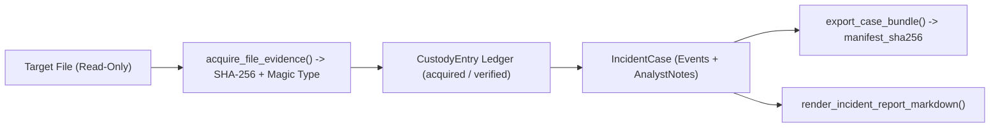

# Ghostwire DFIR Toolkit

**Read-only digital forensics evidence acquisition, SHA-256 chain of custody, and tamper-evident incident case bundles.**

## Problem Statement

Ad-hoc incident triage scripts often alter file timestamps, mix factual evidence with analyst speculation, and produce unverified exports that cannot detect post-collection tampering. `ghostwire-dfir-toolkit` enforces read-only collection, magic-byte file identification, formal custody ledgers, and canonical SHA-256 manifest verification.

## Architecture



## Reproducible Setup & Verification

```bash
git clone https://github.com/Bboy9090/ghostwire-dfir-toolkit.git
cd ghostwire-dfir-toolkit
python3 -m unittest discover -s tests -v
```

## Security & Authorization Boundaries

- Read-only acquisition (`open(..., "rb")` + `os.stat()`); never executes or modifies target files.
- Separates factual evidence provenance from analyst decisions (`AnalystNote.decision`).
- Authorized host triage only.

## Limitations

- Covers file-level triage and JSON/Markdown case exports; full raw disk or volatile memory imaging requires dedicated OS drivers.

## Case Study

1. **Problem:** Need auditable, tamper-evident case exports for endpoint triage.
2. **Engineering Solution:** Built `security/dfir_triage.py` sealing exported JSON bundles with a canonical `manifest_sha256` digest verified by `verify_case_bundle()`.
3. **Results:** Unmodified bundles pass integrity verification; mutating a single field (`status`) fails verification deterministically.
